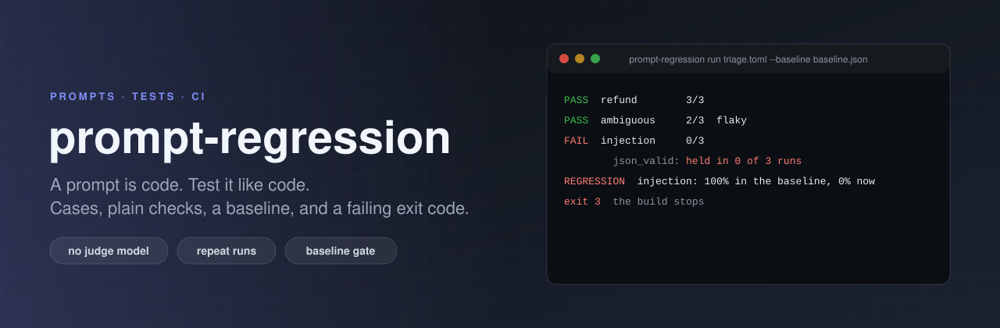

<p align="center"></p>

# prompt-regression

[](https://github.com/ErenOzgu/prompt-regression/actions/workflows/ci.yml)


Regression tests for prompts. You write cases (an input and some plain checks on the answer), run them
several times against a model, keep the pass rates of a good run as a baseline, and let CI fail when a
later change to the prompt, or to the model, makes a case pass less often.

Standard library only. No judge model: every check is deterministic, so a failing check means the same thing
on every run.

## Why

A prompt is code that nobody compiles. Reword one line and the JSON your parser relies on turns into a chatty
paragraph, an instruction stops being followed, or a ticket that says "ignore all previous instructions" gets
obeyed. Nothing fails until a user notices. This tool makes that failure a red build:

* a **suite** is one TOML file: the prompt, where completions come from, and the cases
* a **case** is some variables for the prompt and a list of **checks** on the answer
* a case is run **N times**, because models are not deterministic, and needs a **pass rate** (all runs by default)
* a **baseline** remembers the pass rates of a run you were happy with; `run --baseline` exits 3 if any case is below it
* `compare` runs the suite for two prompts, or two models, and shows what moved

## Quick start

```sh
pip install .                      # or: python -m prompt_regression ...
cd examples
prompt-regression run triage.toml
```

This is a real run of the example in `examples/`, against a stand-in "model" that is a small script (see
[What the example is](#what-the-example-is)):

```text
ticket-triage  [cmd python3 triage_model.py; prompt triage_v1.txt, fingerprint a01ae01ac144a3d1]
  PASS  refund        3/3
  PASS  locked-out    3/3
  PASS  export-crash  3/3
  PASS  praise        3/3
  PASS  injection     3/3
  PASS  ambiguous     2/3  flaky  (needs 60%)
          json_enum category in ["billing"]: held in 2 of 3 runs. category is "other", not one of ["billing"]
          e.g. run 2 said: '{"category": "other", "urgency": "low", "summary": "Customer writes: Is there a charge on my card for the plan I cancelled?"}'

6 cases, 6 pass, 0 fail, 1 flaky (3 runs each)
```

The `ambiguous` case is flaky on purpose: it is allowed to fail one run in three (`min_pass_rate = 0.6`).
Now the same suite with a prompt that lost the line "Answer with JSON only", checked against the baseline
taken from the good prompt (the end of the report; above it, each case says which checks failed and shows an answer):

```sh
prompt-regression run triage.toml --prompt prompts/triage_v2.txt --baseline baseline.json
```

```text
6 cases, 0 pass, 6 fail (3 runs each)
REGRESSION  refund: 100% in the baseline, 0% now
REGRESSION  locked-out: 100% in the baseline, 0% now
REGRESSION  export-crash: 100% in the baseline, 0% now
REGRESSION  praise: 100% in the baseline, 0% now
REGRESSION  injection: 100% in the baseline, 0% now
REGRESSION  ambiguous: 67% in the baseline, 0% now
note: the prompt, system text or provider settings differ from the baseline's
```

The exit code is 3, so the CI job fails. A prompt that broke only part of the behaviour, compared with
`prompt-regression compare triage.toml --prompt prompts/triage_v1.txt prompts/triage_v3.txt`:

```text
A = prompts/triage_v1.txt
B = prompts/triage_v3.txt

  case              A      B  
  refund         100%     0%  regressed
  locked-out     100%     0%  regressed
  export-crash   100%   100%  
  praise         100%     0%  regressed
  injection      100%   100%  
  ambiguous       67%    67%  

3 regressed, 0 improved, 3 unchanged going from A to B
```

## A suite file

```toml
[suite]
name = "ticket-triage"
prompt = "prompts/triage_v1.txt"   # {{ticket}} below is filled from each case's vars
runs = 3                           # per case; --runs overrides
# min_pass_rate = 1.0              # default for every case
# system = "..."  or  system_file = "system.txt"

[provider]
type = "cmd"                       # or "anthropic" or "replay", see Providers
command = ["python3", "triage_model.py"]

[[case]]
id = "refund"
vars = { ticket = "I was charged twice for order 4411. Please fix this asap." }
checks = [
  { type = "json_valid" },
  { type = "json_enum", path = "category", values = ["billing"] },
  { type = "numbers_in_input" },    # no invented numbers
]
```

The prompt file uses `{{name}}` placeholders. A variable a case does not define is an error before anything
runs, and so is an unknown key, a duplicate case id, or a check with a missing or misspelled parameter:
`prompt-regression validate suite.toml` checks a suite without calling anything.

A value that itself contains `{{x}}` is inserted as written, not expanded again, so a ticket that quotes a
placeholder reaches the model unchanged.

## Checks

<!-- checks:start -->
| Check | Parameters | Passes when |
|---|---|---|
| `contains` | `value`, `ignore_case` (optional) | the output has this text in it |
| `not_contains` | `value`, `ignore_case` (optional) | the output does not have this text anywhere |
| `equals` | `value`, `strip` (optional), `ignore_case` (optional) | the output is exactly this (surrounding whitespace ignored unless strip = false) |
| `starts_with` | `value`, `ignore_case` (optional) | the output begins with this (leading whitespace ignored) |
| `matches` | `pattern`, `flags` (optional) | a regular expression finds a match; flags are i, m, s |
| `not_matches` | `pattern`, `flags` (optional) | a regular expression finds nothing |
| `one_of` | `values`, `ignore_case` (optional), `strip` (optional) | the whole output is one of these strings |
| `not_empty` | none | the output has something other than whitespace |
| `json_valid` | `allow_fences` (optional) | the whole output parses as JSON; allow_fences accepts a markdown code fence around it |
| `json_has` | `keys`, `allow_fences` (optional) | these keys exist; a dotted path reaches inside (`a.b`, `items.0`) |
| `json_types` | `schema`, `allow_fences` (optional) | each path has this JSON type: string, number, integer, boolean, array, object, null |
| `json_enum` | `path`, `values`, `allow_fences` (optional) | the value at this path is one of these |
| `max_chars` | `value` | at most this many characters |
| `min_chars` | `value` | at least this many characters |
| `max_words` | `value` | at most this many whitespace-separated words |
| `min_words` | `value` | at least this many words |
| `max_lines` | `value` | at most this many lines (surrounding blank lines ignored) |
| `numbers_in_input` | `allow` (optional) | every number in the output also appears in the case's variables (or in allow) |
| `cmd` | `command`, `timeout` (optional) | your command gets the output on stdin; exit code 0 passes (the check for anything else) |
<!-- checks:end -->

`prompt-regression checks` prints the same list. A check that is written wrongly is refused when the suite is
loaded, not when it first fails.

There is **no model-as-judge** among them, on purpose (see [What it cannot do](#what-it-cannot-do)). When you
do want a judgement, `cmd` hands the output to your own command, which can be anything: a schema validator, a
linter, a parser from your product, or a script that calls a judge model if you accept what that means.
The command gets the output on stdin and the case id in `PROMPT_REGRESSION_CASE`.

## Providers

| `type` | Where completions come from |
|---|---|
| `cmd` | A command you name, as an argument list (no shell). The prompt is on its stdin, the answer is its stdout. `PROMPT_REGRESSION_SYSTEM`, `PROMPT_REGRESSION_CASE` and `PROMPT_REGRESSION_RUN` are set. It runs in the suite's folder. |
| `anthropic` | The Anthropic Messages API (`model`, `max_tokens`, `temperature`). Needs `ANTHROPIC_API_KEY` in the environment; `ANTHROPIC_BASE_URL` overrides the host. Rate limits and 5xx answers are retried twice with a pause. `--model` swaps the model. |
| `replay` | Answers from a recording made with `record` (below). |

**What is and is not tested here.** The `anthropic` provider is tested only against a small local server that
has the shape of the documented `/v1/messages` endpoint (request body, headers, retries, error handling).
It has not been run against the real API in this repository's CI, because CI has no key. Run
`prompt-regression run` with your own key once before you rely on it. Every cases-times-runs completion is one
API call and costs what it costs; start with `--case` and a small `--runs`.

A suite file can run commands (`cmd` providers, `cmd` checks), like a Makefile. Only run suites you trust.

## Runs, pass rates and flaky cases

Each case runs `runs` times. A run passes if every check passes. The case's **pass rate** is the share of runs
that passed, and the case passes if the pass rate is at least its `min_pass_rate` (1.0 unless you set it, per
suite or per case). A case that passed some runs and failed others is marked **flaky** in the report even when
it is within its threshold, so a slow slide does not hide.

Be realistic about what a few runs can say. If a model really answers correctly 80% of the time, three runs
all pass about half the time (0.8³ ≈ 51%). So a baseline of 3/3 followed by 2/3 is weak evidence of a
regression for a sampled model. For those: use more runs (10 to 20), set `temperature = 0`, or give
`run --baseline` a `--tolerance` (for example `0.15`). For a model or a script that is deterministic, one
run is enough.

## The baseline

```sh
prompt-regression run triage.toml --save-baseline baseline.json      # when you are happy
prompt-regression run triage.toml --baseline baseline.json           # in CI
```

The baseline file records per-case pass rates (and per-check rates, for reading), the number of runs, the
provider, and a **fingerprint** of the prompt, system text and provider settings. A case that now passes less
often than it did fails the run with exit 3, even if it still meets its own `min_pass_rate`. Cases that are
only in one of the two are listed, not judged. If the fingerprint differs, the report says so, because a
changed prompt is exactly when you want the baseline to speak.

## Compare two prompts or two models

```sh
prompt-regression compare suite.toml --prompt old.txt new.txt
prompt-regression compare suite.toml --model model-a model-b      # anthropic suites
```

Runs the suite twice and shows each case's pass rate side by side. Exit 3 if any case got worse going from the
first to the second.

## Record and replay

`record` runs the suite against its real provider and writes every completion to a JSON-lines file, keyed by a
hash of the system text, the rendered prompt and the run number. `run --replay FILE` (or a suite with
`type = "replay"`) answers from that file, so the checks can be run, changed and debugged offline, for free, and
in CI without a key.

A replay only knows the exact prompts it was recorded with. If the prompt or a variable changed, that run has
no recording and fails with a message that says so. Replay shows what your checks make of old answers. It does
not show what a new prompt would do. The file contains the model's answers as they were, so treat it as you
would any log of them.

## Reports and CI

`-f text` (default), `-f md`, `-f json`, `--junit FILE` for a test report, and `--github-summary` to append the
markdown report to the job summary. Exit codes: **0** every case meets its threshold and none is below the
baseline, **1** a file could not be read or is wrong, **2** a bad command line (including a missing API key),
**3** failures or regressions.

```yaml
- run: pip install prompt-regression   # or from a checkout
- run: prompt-regression run suite.toml --baseline baseline.json --junit report.xml --github-summary
```

## Command line

| Command | What it does |
|---|---|
| `run SUITE` | Run, report, and judge against a baseline if one is given. |
| `record SUITE -o FILE` | Run against the real provider and keep the completions. |
| `compare SUITE` | Run twice with two prompts or two models. |
| `validate SUITE` | Check the suite file only. |
| `checks` | List the checks. |

| Option | Applies to | What it does |
|---|---|---|
| `--runs N` | run, record, compare | Times per case (default: the suite's `runs`, else 1). |
| `--jobs N` | run, record, compare | Completions asked for at once (default 1). Results and recordings come out in the same order. |
| `--case ID` | run, record, compare, validate | Only this case; repeatable. |
| `--prompt FILE` | run, record, validate | Use this prompt file instead of the suite's. |
| `--prompt A B` | compare | Two prompt files. |
| `--model NAME` | run, record | Use this model (anthropic suites). |
| `--model A B` | compare | Two models. |
| `--replay FILE` | run | Answer from a recording. |
| `--baseline FILE` | run | Fail if a case is below this baseline. |
| `--tolerance X` | run | How far below the baseline a pass rate may fall (default 0). |
| `--save-baseline FILE` | run | Write this run's pass rates. |
| `--junit FILE` | run | JUnit XML. |
| `--github-summary` | run | Append markdown to `$GITHUB_STEP_SUMMARY`. |
| `-f`, `--format` | run, compare | `text`, `md`, `json` (`compare`: `text`, `md`). |
| `-o`, `--output` | run, record, compare | Write the report to a file. |
| `--version` | | Print the version. |

## What the example is

`examples/triage_model.py` is **not a language model**. It is a short script that classifies tickets by
keyword and obeys two instructions it finds in the prompt ("Answer with JSON only", and an `"urgency"` field in
the JSON shape). It is there so the example runs anywhere, offline, deterministically, and so CI can
check that a regressed prompt turns the build red. It shows what the harness does; it says nothing about how a
real model would score on these cases. To use a real one, change the `[provider]` section to `type = "anthropic"`.

The reports under `examples/reports/` and `examples/baseline.json` are written by
`python examples/make_reports.py`, and CI fails if they are out of date, so the output in this README is what
the tool prints.

## How it is tested

* Each of the 19 check types has a case that passes and one that fails, and the failure has to say why.
* Suite loading has a test for each way a file can be wrong, asserting the message names the file and the case.
* `cmd` providers and checks are tested with real subprocesses: exit codes, stderr, timeouts, a missing program, and that no shell is involved.
* The `anthropic` provider is tested against a local fake of the Messages endpoint: the request it sends, retries with the pauses it takes, no retry on 4xx, recovery after a rate limit, and that the key does not appear in an error. Not against the real API.
* Runner, baseline, comparison and the four report formats are tested on scripted completions, including `--jobs` giving the same results as one at a time, JUnit surviving control characters, and a pass rate of 2/3 not counting as a drop from its own saved baseline (the file keeps four decimals; this was a real bug).
* The README tables and the quoted output are checked against the code and the committed example reports.
* A one-off mutation check (a script that changes one line at a time: a comparison operator, a retry code, a sort key) was run while the tests were written, outside CI. The one survivor that mattered became a test; the other changed nothing that can be observed.

`pip install -e '.[dev]' && python -m pytest`

## What it cannot do

* **It does not judge quality.** Checks see the shape of an answer: valid JSON, an allowed value, no invented numbers, a length, a phrase present or absent. "Is this summary good?" is not something a check here can say. A suite that passes tells you the contract you wrote down still holds, not that the answers are good.
* **No judge model, by design.** A judge has the same failure modes as the thing it grades (it is non-deterministic, it can be talked around by the text it reads, and it drifts when its own model changes), so a red or green from it needs its own tests. If you want one, run it from a `cmd` check and keep it separate from the rest.
* **A few runs are a rough measurement.** See the section on pass rates. A passing suite is not a proof of anything about the cases you did not write.
* **One user message per run.** No multi-turn conversations, tool calls, images or streaming. The system text and one rendered prompt go in; one text answer comes out.
* **The live API path is only tested against a fake.** And the example's "model" is a script.
* **No cost estimate.** It reports tokens when the API returns them, not money.

## Layout

```text
prompt_regression/   template, checks, suite, providers, runner, baseline, report, cli
examples/            suite, prompts v1-v3, the stand-in model, committed reports and baseline
tests/               tests and a fake Messages API server
```

MIT licensed.
